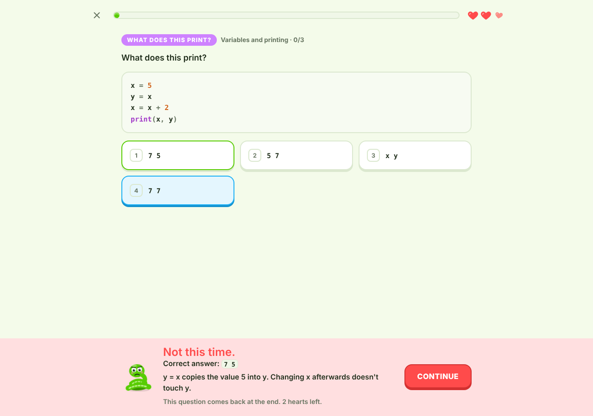
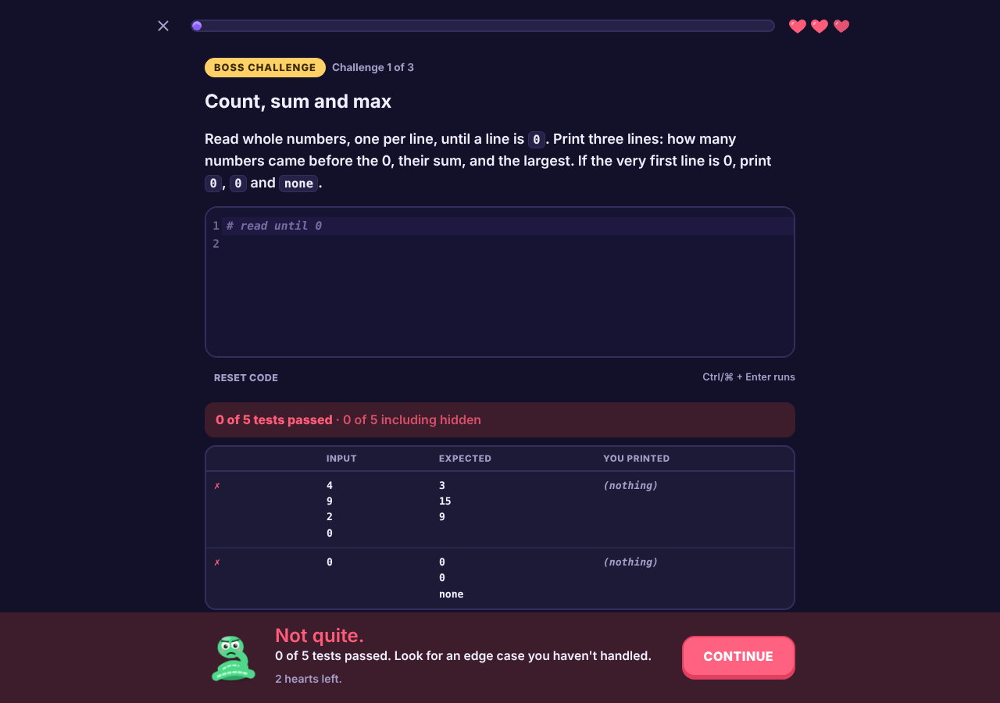
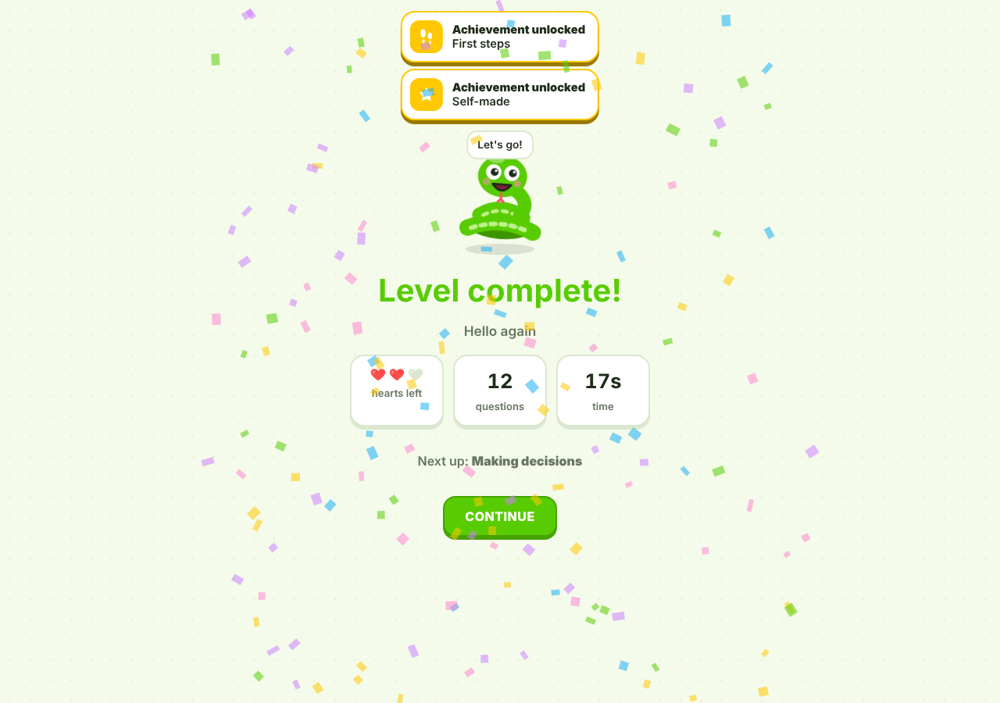

# Zero to LeetCode

A game that takes you from "I haven't written a while loop in a year" to LeetCode-ready Python. You follow a winding level path with Pip the snake, read a short lesson, then answer questions in real Python that runs in your browser. Each unit ends with a boss fight.


## What's in it

- **30 levels across 6 units.** Unit 0 starts from `print` and `input`. Unit 1 covers interview Python, the standard toolkit, Big-O and recursion. Units 2–4 cover the 12 core LeetCode patterns: hashing, two pointers, sliding window, stacks, binary search, linked lists, trees, heaps, backtracking, graphs, DP, intervals and greedy. Unit 5 is about how to practise.
- **237 questions in four types:**
  - **What does this print?** You read code and pick its output.
  - **Fill in the blank.** You type the missing expression, and it runs against tests.
  - **Fix the bug.** Broken code goes into a real editor, and you make the tests pass.
  - **Write the code.** A full exercise with tests. Several also link to the matching LeetCode problem.
- **Mastery, not luck.** Every skill has several questions, and a wrong answer goes back into the queue, so you have to get it right again later.
- **Hearts that send you back to learn.** You get 3 hearts per level, and only the quick-answer questions (what does this print, fill in the blank) cost them. Running your code is always free. Lose all 3 and you're sent back over the lesson. You return with full hearts and the helper unlocked, and your progress in the level is kept.
- **A helper that gives away a bit at a time.** It unlocks after 3 failed tries and goes hint, then explanation, then the answer. If the helper reveals the answer to a question, that question comes back once more so you still have to get it on your own.
- **Boss levels.** Three harder challenges with hidden tests, and a failed submit costs a heart. You get no lesson and no solutions.
- **Practice mode.** It re-tests the questions you got wrong, mixed with questions from levels you've finished.
- **Extras:** 18 achievements, a daily streak, four themes, synthesised sound effects (no audio files) and 137 real LeetCode problems to tick off.

| | |
|---|---|
|  |  |
|  |  |

## Every answer is checked by running it

The content is written in Python (`content/`), and `content/build_content.py` turns it into `src/content/content.json`. Along the way it:

- runs the code in every "what does this print" question and uses the **real output** as the correct option. It fails if a wrong option happens to match.
- computes the expected results for fill-in and fix-the-bug questions from the reference answer. It checks that the buggy version really fails, and that junk answers like `0`, `None` or `True` don't pass.
- runs every coding solution and boss solution against its tests. Two bosses are also cross-checked against brute force.
- times out anything that loops forever.

The GitHub Action runs this on every push, so a wrong answer can't be deployed.

## How it runs

- **React + TypeScript + Vite**, with no UI framework. The mascot, icons and road are hand-drawn SVG, and the animations are CSS.
- **Pyodide** runs CPython (compiled to WebAssembly) inside a Web Worker. Infinite loops get killed after 10 seconds instead of freezing the tab. The worker builds a small test harness around your code and reports each test case back.
- **CodeMirror 6** is the editor, and **Prism** highlights the read-only code.
- Progress is stored in `localStorage`. Nothing you type leaves your browser.

## Run it locally

```bash
npm install
pip install markdown        # only needed to rebuild the content
npm run content             # verify every question and regenerate content.json
npm run dev
```

`npm run build` writes a static site to `dist/`. The site loads Pyodide from jsDelivr, or from another URL if you add `?pyodide=<url>`.

## Deploy

Push to `main`. The workflow in `.github/workflows/deploy.yml` verifies the content, builds the site and publishes it to GitHub Pages. In the repo's settings, go to Pages → Source and choose **GitHub Actions**.

## Project layout

```
content/            question bank (Python) + the build/verify script
  lessons/*.md      lesson text, split into cards at each "## " heading
  drills*.py        coding questions with tests
  game.py           quick questions, skills per level, bosses
  harness.py        the Python test harness that also runs in the browser
src/
  lib/python.ts     Pyodide worker, timeouts, test running
  screens/          path, lesson cards, question session, helper, panels
  components/       questions, editor, Pip, icons
  styles/app.css    four themes and all the animation
```

## Licence

MIT
